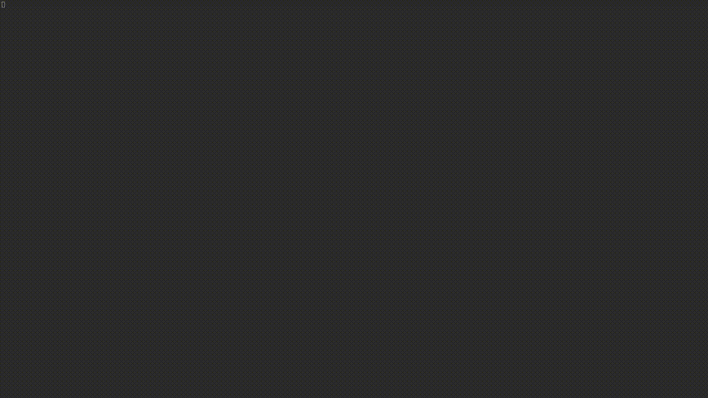

# screencaster

Write a YAML script, run one command, get a narrated MP4 of a website.



## Install

Docker (run from the project folder): download the wrapper once, then run it like the `screencaster` binary. It embeds the Chromium sandbox's seccomp profile (see "Chromium sandbox" below), so nothing else to fetch. The image's own default user is a fixed, unprivileged `65532:65532` (security audit M8); the wrapper always passes `--user $(id -u):$(id -g)` too, so output files belong to you, not to that default or to root.

```bash
curl -fsSLO https://github.com/makuchpatryk/screencaster/releases/latest/download/screencaster-docker
chmod +x screencaster-docker
./screencaster-docker render demos/my-demo.yaml
```

Native (Debian/Ubuntu, linux amd64), from a [release](https://github.com/makuchpatryk/screencaster/releases):

```bash
curl -fsSLO https://github.com/makuchpatryk/screencaster/releases/download/vX.Y.Z/screencaster_X.Y.Z_linux_amd64.tar.gz
curl -fsSLO https://github.com/makuchpatryk/screencaster/releases/download/vX.Y.Z/SHA256SUMS
sha256sum -c SHA256SUMS --ignore-missing
tar xzf screencaster_X.Y.Z_linux_amd64.tar.gz
sudo ./screencaster setup
./screencaster render demos/my-demo.yaml
```

Every release publishes `SHA256SUMS` next to the tarballs and `screencaster-docker` (security audit M7); `--ignore-missing` skips the architecture you did not download. Each `release` run also verifies `ci.yml`/`release.yml`'s own actions and the Docker base images are pinned by SHA/digest, not a mutable tag (security audit M6).

## Demo

`demos/my-demo.yaml`:

```yaml
name: my-demo
languages: [en]
steps:
  - goto: http://172.17.0.1:3000/projects
  - click: role=button[name="New project"]
    narration:
      en: Click the New project button.
  - fill: { selector: 'input[name="name"]', value: My Project }
```

- Paths are relative to the demo file. `goto` must be an absolute URL.
- Docker: `172.17.0.1` is the host on Linux, `host.docker.internal` on Docker Desktop. The app must listen on `0.0.0.0`.
- `narration` is optional per step.

More (login cookies, intro/outro cards, screenshots, voices): [docs/PRD.md](docs/PRD.md).

## Claude Code (MCP)

Add to the project's `.mcp.json`. Replace `<project>` with the absolute path of the folder that holds `demos/`, `<uid>:<gid>` with the output of `id -u` and `id -g`, and `<screencaster>` with the absolute path of this repo, which has the seccomp profile the Chromium sandbox needs (JSON does not run the shell, so type the numbers and paths):

```json
{
  "mcpServers": {
    "screencaster": {
      "command": "docker",
      "args": ["run", "-i", "--rm", "--init",
               "--user", "<uid>:<gid>",
               "--security-opt", "seccomp=<screencaster>/scripts/seccomp-chromium.json",
               "-v", "<project>:/work", "screencaster", "screencaster-mcp"]
    }
  }
}
```

The `screencaster` image name comes from `make image`, or `docker tag ghcr.io/makuchpatryk/screencaster screencaster`.

Prompt: `/mcp__screencaster__create_demo [description]`.

## Chromium sandbox

Chromium's own sandbox is on by default (decision 83) and never falls back to `--no-sandbox`; a render fails closed if it cannot start.

- **Docker**: the sandbox needs to create several namespaces unprivileged (user, pid, net, ...), which Docker's own default seccomp profile reserves for processes with `CAP_SYS_ADMIN`. `screencaster-docker` (the release asset above) and `compose.yaml` already pass the fixed-up profile below; a raw `docker run` of the `screencaster` image needs `--security-opt seccomp=scripts/seccomp-chromium.json` (from this repo) too, or the render fails with the error below.
- **Native** (Debian/Ubuntu, linux amd64): `sudo ./screencaster setup` installs an AppArmor profile automatically, but only on a kernel that restricts unprivileged user namespaces (Ubuntu 24.04+); elsewhere there is nothing to install. `setup --check` reports the `sandbox` piece.
- **Error you'll see without either**: `launch chromium with its sandbox (see README "Chromium sandbox"): <<the underlying launch error>>`.

`scripts/seccomp-chromium.json` starts from Docker's own default profile, copied byte-for-byte from `moby/profiles` at commit `6fe7deb1b9fb7c0397a4593480d7d22b9ee8caef` (2026-09-17), plus one added rule: that stock profile only lets an unprivileged process create a namespace (`clone`/`unshare`/`setns`) when none of `CLONE_NEWUSER`/`NEWPID`/`NEWNET`/`NEWNS`/`NEWIPC`/`NEWUTS`/`NEWCGROUP` are set, which blocks Chromium's own unprivileged sandbox outright; the added rule allows exactly those flags (still nothing CAP_SYS_ADMIN-gated, like `mount` or `bpf`) and is commented in the file with the exact `strace` evidence. See `docs/ARCHITECTURE.md` §14 for the full writeup.

## Docs

[PRD](docs/PRD.md) · [ARCHITECTURE](docs/ARCHITECTURE.md) · [CODE_QUALITY](docs/CODE_QUALITY.md)

## Development

Host needs only Docker.

```bash
make image    # build the image
make test     # go test -race ./...
make lint     # golangci-lint
make e2e      # real Chromium, Piper, ffmpeg
```
